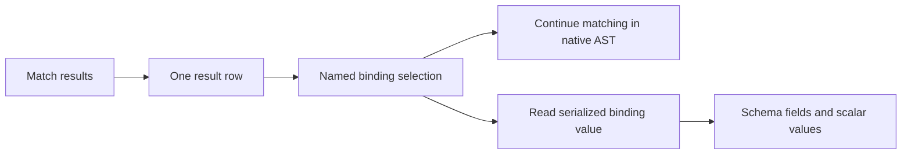

Source: Existing personal wiki pages
Fetched: 2026-10-10
Description: Context snapshots; current worktree takes precedence for UI delivery

## pages/planning/clang-toolkit-console-design.md

---
name: Clang Toolkit console design
type: planning
status: implemented
last_updated: 2026-10-09
sources: 20
tags: [clang-toolkit, console, repl, semantic-fields, design]
---

# Clang Toolkit console design

Editable Page: [Clang Toolkit Console Design Draft](https://chatgpt.com/space/page_777598d782a881919c3750613445c1c8).

Cloud Page sync verified on 2026-10-09: sequence 12 applied all seven operations; readback confirmed 94 original unrelated blocks were preserved and the Page now has 103 blocks. This is the current sync status; the prior blocked attempt remains in the log as historical context.

The console now exposes serialized match fields through read-only schema views. The first implementation preserves native binding selection for further matching and adds bounded iteration, inspection, and nested field completion. The user authorized implementation on 2026-10-07; function declaration fields now have direct schema-backed access, while native server-script parity remains a future design decision.

## Implementation verification

The direct-field follow-up on 2026-10-08 verified all 488 Python unit tests and 66 console/server scenarios, six concrete function declaration payload kinds in a native C++20 fixture, local Tab completion without parse/match requests, and continued native binding selection. Its recursive child-field expectations predate the shallow match contract below: parameters, bodies and other child AST values are now `UNREQUESTED` in match results and require follow-up matches. Final shallow-value evidence is in source 17; selected-subtree performance and traversal evidence is in source 18; ordinary display behavior is in source 19.

Implemented in the working checkout on 2026-10-07: `.value` field views, explicit binding maps, presence checks, numeric and string indexing, bounded `foreach`, nested completion, `inspect`, and bounded display. Selected semantic views retain copied protobuf bytes.

Historical verification before shallow match results, after the history follow-up on 2026-10-08: all 471 Python unit tests pass in the working checkout, and all 66 console/server scenarios pass. Four key-driven scenarios cover persisted Up/Down navigation, editing drafts, multiline recall, Ctrl+R acceptance and history clearing. Two actual manual-console launches preserve the same history file after launcher cleanup; the restarted process recalls `HISTORY_BETA` with Up and finds `HISTORY_ALPHA` with Ctrl+R, with exactly one record per submitted command and separate session UUIDs. The native Widget fixture still exposes `Widget::run` and parent type spelling `Widget` without parse/match requests during completion. The preceding native C++ verification covered all 268 tests across the parallel run and an isolated streaming-deadline rerun; these follow-ups change console behavior only.

The isolated source copy initially lacked the ignored build-version stamp; copying the existing stamp resolved two version checks. Native storage tests use a separate cache root per test to avoid shared-cache contention. The parallel C++ run passed 267 tests; one streaming deadline check passed when rerun alone. Integration preserved 56 unrelated dirty paths. Sources 1-5 describe the pre-implementation baseline; source 13 records the implemented flow.

### Selected-subtree performance follow-up

On `cache_state.cpp`, the first main-file constructor, `ctk::cache::SnapshotCache::Impl::Impl`, returned complete selected-subtree results in two repeated runs. The rooted walk reduced elapsed matching time from 1.313/1.297 seconds to 0.019/0.012 seconds, while results changed from 65 rows/54,335 bytes to 57 rows/50,715 bytes.

| Run | First result | Total | Rows | Serialized bytes | Outcome |
| --- | ---: | ---: | ---: | ---: | --- |
| Before, pass 1 | 1.298 s | 1.313 s | 65 | 54,335 | Complete |
| Before, pass 2 | 1.283 s | 1.297 s | 65 | 54,335 | Complete |
| Rooted walk, pass 1 | 0.007 s | 0.019 s | 57 | 50,715 | Complete |
| Rooted walk, pass 2 | 0.002 s | 0.012 s | 57 | 50,715 | Complete |

The row delta removes eight out-of-root `FieldDecl` initializer occurrences; the selected constructor's own `CXXDefaultInitExpr` descendants remain. In the `AS_IS` path, a bounded visitor walks native `Decl` and `Stmt` candidates under the selected root. Match evaluation retains the full `ASTContext` for relationship predicates, and duplicate callback occurrences inside the rooted walk remain preserved. Source-spelled traversal and the derived-from alias family keep the prior whole-translation-unit route for Clang metadata and context parity.

The reported minute-scale case was not reproduced because its source file was unavailable. These timings describe this `cache_state.cpp` fixture only. Forty-four unique native MatchCursors and ClangQuery checks passed: the 42-check suite ran in 54.16 seconds, followed by isolated streaming and final constructor regression checks; the corrected implicit-copy-selection assertion passed on rerun. One actual-console end-to-end scenario passed in 11.19 seconds. The backend, regression test and documentation were integrated as three files, and the live build passed. The active user server has not been restarted; restart it, then reparse and rematch before treating the running service as verified against this change.

## Expression-oriented operations

The 2026-10-10 language extension treats operational commands as values in
assignments, containers and grouped expressions, with automatic display confined
to standalone execution. Assigned brace `foreach` collects the final value of
each iteration. `batch` returns its status report and bounded detached final
group values; consuming it suppresses body/report/progress display, while
standalone progress defaults to on and accepts `progress off`. The resource and
escape contract is in [[pages/planning/clang-toolkit-open-files-and-batches]];
the concrete language specification is
`/Users/husam/workspace/clang-toolkit/docs/expression-values.md`. [20]

## Goal

For a developer exploring a C++ file, printing function names or return types should be a short console operation. Success means selecting one result, discovering its available fields, extracting a scalar, and iterating over results without exporting JSON or writing a separate SDK program.

### Public match result policy

Public match results expose immediate properties of each matched node; match serialization does not traverse AST child fields. Deliberately omitted child fields are marked `UNREQUESTED`, and `is_complete=true` means the immediate projection is complete. Internal recursion used by non-match operations remains unchanged. `QualType.description.spelling` and `QualType.description.canonical_spelling` are immediate type facts; child data such as `return_type.type`, parameters, bodies, parent records, initializers and operands requires follow-up matching.

## Behavior before implementation

The working checkout already supports retained `let` results, row indexing, binding selection, and continuation. Its result rows contain typed protobuf values; JSON is their display format. The missing step is access from a binding selector to its serialized semantic data.

| Expression | Current behavior |
| --- | --- |
| `$functions[0].f` | Returns a `BindingSelection` for row zero and binding `f`. |
| `$functions[0].f.name` | Returns the binding label `f`, through the selector's public dataclass field. |
| `$functions[0].f.node` | Fails with `unknown field: node`. |
| `$functions[0].f.value` | Fails with `unknown field: value`. |
| `foreach $row in $functions do $row.f.name done` | Fails with `foreach requires a list`. |

These behaviors were reproduced through the checkout's Python runtime with a constructed protobuf row on 2026-10-07. The row contained `sample::alpha` at `node.function_decl.function.declarator.value.named.qualified_name`; its contents were readable through the SDK's protobuf binding map. This probe used no server and does not establish live serializer coverage. See sources 1–5.

> Conflict: [[pages/planning/clang-toolkit-interactive-runtime]] still describes assignment and transport as unwired. The current source and local probe supersede those statements for this design. The checkout also contains uncommitted streaming and retained-value work; the baseline here describes the working files, not only the last commit.

## Approaches considered

| Approach | Benefit | Main cost or limitation |
| --- | --- | --- |
| Convert every result to a JSON record | Quick access to dictionary keys. | Loses reliable presence and scalar types and encourages eager conversion of large results. |
| Typed schema fields | Covers serialized fields with one descriptor-driven resolver. | Exposes nested schema paths. Recommended foundation. |
| Common semantic shortcuts | Makes names and return types concise. | Needs explicit mappings for each supported concrete node and collision rules. |
| General Python or JavaScript console | Familiar programming model. | Replaces the existing language and changes execution and compatibility guarantees. |
| Server projection language | Can reduce transferred data for large queries. | Adds an API and server execution feature beyond the initial console gap. |

The recommended foundation is typed schema access, using the existing Lark language. Function declaration conveniences follow an explicit base metadata chain, with exact schema paths preserved. No new RPC is required for fields already carried in a result.

## Proposed value model



A match collection retains row order and multiplicity. A row contains named bindings. A binding selection identifies native match roots and may expose its copied semantic `MatchBinding` through `.value` when it selects exactly one row. The semantic view exposes schema fields, nested messages, repeated fields, and maps without exposing arbitrary Python attributes or methods.

| Proposed form | Meaning |
| --- | --- |
| `$functions[0].f` | Existing selection for continuation. |
| `$functions[0].f.value` | Read-only semantic `MatchBinding` view for one binding. |
| `$functions[0].f.value.node` | Active AST node value. |
| `$functions[0].f.value.is_complete` | Binding completeness metadata. |
| `$functions[0].bindings["f"]` | Explicit selection by bind name; avoids collisions with properties. |
| `$functions.f.value` | Cardinality error, even when there happens to be one result; use an explicit row. |

The explicit `.bindings["name"]` form is new syntax. Extend string-key indexing for binding maps while preserving zero-based numeric indexing for result rows and repeated fields. Bindings such as `length`, `isEmpty`, or `bindings` must remain accessible through the explicit map.

Preserve `.name` on existing selectors as the bind label. On `.value.node`, `.name` remains the structured `DeclarationName`; ordinary identifier names use `.name.identifier`, and `.qualified_name` is the scalar native qualified string. Operators, constructors, destructors, conversions and deduction guides retain their structured name variants in the semantic schema.

## Proposed console flow

The `.value`, `.bindings`, semantic iteration, and `inspect` examples below are implemented in the Python console.

```text
let tree = parse "examples/parse_match.cc";
let functions = match functionDecl(isDefinition()).bind("f") in $tree;

let first = $functions[0].f.value;
print $first.node.function_decl.function.declarator.value.named.qualified_name
print $first.node.function_decl.function.return_type.description.spelling

let names = foreach $row in $functions do
    $row.f.value.node.function_decl.function.declarator.value.named.qualified_name
done
print $names

let calls = match callExpr().bind("call") in $functions[0].f;
```

Reading serialized fields makes no server request. The continuation still uses the existing native selection. A semantic field that contains another serialized node is readable data; it does not acquire native continuation capability.

## Field and collection rules

Use the schema's `snake_case` field names. Return strings, booleans, and exact integers as their corresponding runtime values. Nested messages remain read-only field views; repeated fields support numeric indexing, length, and iteration. Enum values retain their symbolic name and numeric value and render with the symbolic name. Unknown enum numbers remain representable.

Check presence before reading optional scalars, messages, or oneof branches. An absent value produces a field-unavailable error; `false`, `0`, and an explicitly present empty string remain valid values. A schema view offers `hasField("field_name")` for fields that support presence. For fields without presence, use the schema's default semantics. An inactive oneof branch must never appear as an empty fabricated node.

Unknown fields, absent values, unsupported payloads, wrong index types, and out-of-range indices produce distinct errors including the failing reference segment and relevant row. Include existing availability reasons when the server provides them. A match result is a shallow projection of immediate facts for each bound node. Child AST fields are deliberately omitted and marked `UNREQUESTED`; this does not make the projection incomplete. `is_complete=true` means the requested immediate projection is complete. An unsupported value has `is_complete=false`. Internal recursion used by non-match operations remains unchanged. An incomplete binding still permits reads of fields actually present; missing availability metadata does not prove completeness.

Initially, extend `foreach` to `MatchValue` and supported repeated-field views. Keep it explicit instead of making `$functions.f.some_field` silently project across rows. Each row keeps its position and duplicate rows remain duplicated. A missing binding in an explicitly visited row is an error. Failed projection preserves an earlier assigned variable, matching existing assignment behavior. Enforce an iteration bound and a bound on collected output; iteration alone must not load every semantic row into memory.

## Discovery and rendering

Tab completion resolves the full reference prefix locally, including row and map indexing. It labels available immediate schema fields, active payloads and methods. A concrete message payload such as `cxx_method_decl` says to continue with `.`; `hasField(` is labeled as a method that checks field presence. Scalar oneof fields are labeled as active fields without suggesting further nesting. Function nodes complete immediate concrete and inherited declaration metadata; child fields such as parameters, bodies, initializers and operands are hidden when their availability is `UNREQUESTED`. Completion uses descriptors and one local row read, with no remote request or scan of all rows.

Add `inspect $reference` to show the value type, field names, active payload, and availability within a bounded display. A scalar prints directly; a nested message prints a bounded structured view. Explicit JSON export remains available. Collection preview and diagnostic limits should be separate from semantic result retention limits.

### Ordinary JSON display and inspection

Ordinary rendering of semantic values uses `display_value` and preserves the AST's actual JSON fields. It omits protobuf full-name wrappers, synthetic `active_oneof` and method-wrapper entries, and the inspection-only availability array. Real AST fields remain visible, including a node's `type`, active oneof variant keys, and symbolic enum names. Depth and item counts stay bounded. `inspect_value` and the `inspect` command retain their existing rich inspection output unchanged. The integrated Python changes cover `semantic.py`, `values.py`, and `test_semantic_fields.py`; all 494 Python unit tests passed in 1.39 seconds. The semantic-fields and node-completion end-to-end suites passed all three scenarios in 15.87 seconds on the live rebuilt server with the current Python code; 13 fixture deprecation warnings were reported, with no failures.

## Node field navigation and syntax diagnostics

`node` wraps one active concrete payload. The C++ method's immediate declaration metadata includes its qualified name and typed `return_type`; the return type's immediate `description` supplies `spelling` and `canonical_spelling`:

```text
$m[0].f.value.node.qualified_name
$m[0].f.value.node.return_type.description.spelling
$m[0].f.value.node.return_type.description.canonical_spelling
```

`return_type.type` and child AST fields such as the parent record are `UNREQUESTED` in a match result; retrieve child nodes with a follow-up match. `.node.name` remains the structured `DeclarationName`; ordinary identifier names use `.node.name.identifier`, while `.node.qualified_name` is the scalar native qualified string. Operators, constructors, destructors, conversions and deduction guides retain their structured name variants. Direct declaration metadata follows the active payload and explicit base metadata chain for functions, methods, constructors, destructors, conversions and deduction guides; it does not traverse child AST fields. The nearest descriptor owns duplicate immediate field names.

`hasField("field")` checks supported protobuf presence through the same field resolver. Tab inside its argument inserts quoted names, including inactive oneof branches and inherited fields, while preserving an existing closing quote. Repeated fields use `.length` or `.isEmpty`. An empty `hasField()` reports the required field name, location and caret.

Every console command's parser/lexer failure now explains expected syntax and shows its location with a bounded source excerpt and caret. Unknown commands point to help and suggest nearby spellings. Missing quotes, delimiters and values have specific explanations. Prompt validation names the missing closer or `done` and positions the editing cursor. Interpolation syntax errors explain the expected reference syntax and mark the position within the interpolation; missing `}` and invalid string escapes also report their location. Carets handle tabs and wide characters, and invisible marks cannot expand previews without bound.

The original missing-match form reports the insertion point at column 9 and validates the corrected command with the console grammar. These diagnostics cover the console's local language; native server scripts remain a separate language surface.

## Persistent command history

Up and Down recall submitted commands across console restarts; Ctrl+R searches backward through saved history. Enter accepts a search result and the next Enter submits it. Multiline commands remain one entry. The prompt reads the existing JSONL history through a read-only adapter while command dispatch remains the sole persistence writer, preserving timestamps, session UUIDs and labels without duplicate records.

History uses `$XDG_STATE_HOME/clang_tools/history.jsonl`, or `~/.local/state/clang_tools/history.jsonl`. The manual launcher previously forced history into its temporary server directory, which was deleted on exit; it now inherits the same persistent state location as the console. The prompt previously used fresh memory history despite the disk log; it now loads saved commands. Its custom Enter behavior now accepts Ctrl+R search results without inserting a newline into the command.

`history clear` clears saved and cached recall history. Malformed JSONL records are skipped while valid records remain readable. Appending after an unterminated damaged tail adds the missing record separator, preserving earlier bytes and keeping the new command readable. If the history file cannot be read, the console reports the problem, disables persistence for that run and keeps interactive input available. Submitted syntax failures are recorded; cancelled edits are not.

## Architecture and compatibility

The Python console evaluator owns field resolution and rendering. A reusable schema adapter should use protobuf descriptors, check presence, and produce immutable views over copied row data. Indexing and the small supported method set go through explicit dispatch. The grammar, evaluator, highlighting, help, and completion evolve together; no second handwritten parser or unrestricted attribute lookup is introduced.

A selected binding and each semantic view own copied protobuf bytes, so field reads remain available after the native cursor closes. Iteration reads the row store lazily; continuing native matching preserves the existing owner, revision, and cleanup checks.

The native server script language is a separate ANTLR surface. Its current grammar supports binding selectors in match targets, but does not expose general dotted semantic references. Keep native script support as a named later scope decision; presenting console syntax as supported in `script` would be misleading. Shared field naming and error semantics should guide both surfaces if parity is implemented.

## First implementation scope

1. Agree the binding-to-value boundary, exact field syntax, and collision rules using the examples above.
2. Add schema-driven read-only field views, presence checks, numeric and string indexing, and precise local errors.
3. Extend bounded iteration over match results and repeated values; preserve atomic assignment and lazy row reading.
4. Add reference-aware completion, `inspect`, bounded formatting, and console help.
5. Verify the complete flow against a real C++ fixture through the interactive console before declaring field access supported.

Defer arbitrary user code, mutation of result fields, silent collection projection, new server projection RPCs, and reconstruction of native handles from serialized values. These features do not close the initial field-reading gap. Conveniences beyond the explicitly mapped declaration bases and native script parity remain discussion items.

## Acceptance criteria

- Read a function's qualified name and return type through the real console; continue matching from the same binding afterward.
- Distinguish present `false`, `0`, and empty strings from absent optional values and inactive oneof branches.
- Read repeated fields and bindings with names that collide with collection properties.
- Preserve zero matches, unbound rows, repeated rows, and explicit row errors.
- Report unsupported and partial payloads without inventing semantic values.
- Complete nested field paths without server requests or eager result materialization.
- Preserve earlier assignments after failure and document close, expiry, detached export, and stream-completion behavior.

## Open decisions

- Resolved: exact schema paths and direct schema-backed function declaration fields coexist.
- Resolved: `.value` is the semantic-data boundary; selector `.name` continues to mean the bind label.
- Resolved: absent optional fields and inactive oneof branches raise precise errors; `hasField` checks supported presence.
- Resolved for function declarations: expose concrete and inherited descriptor fields through the explicit base chain; preserve typed names, owner paths and presence semantics.
- Should native server scripts gain field access in the same delivery or a later phase?

## Sources

1. `/Users/husam/workspace/clang-toolkit/python/clang_toolkit/cli/runtime/references.py:22` — selector property dispatch and current supported field access.
2. `/Users/husam/workspace/clang-toolkit/python/clang_toolkit/match_values.py:77` — selectors, immutable rows, binding copies, and lazy result access.
3. `/Users/husam/workspace/clang-toolkit/python/clang_toolkit/cli/runtime/evaluator.py:234` — current completion fields; `:480` reference evaluation; `:611` list-only foreach.
4. `/Users/husam/workspace/clang-toolkit/python/clang_toolkit/cli/runtime/values.py` — current JSON row rendering.
5. `/Users/husam/workspace/clang-toolkit/python/clang_toolkit/cli/grammar.lark:150` — reference grammar and numeric indexing.
6. `/Users/husam/workspace/clang-toolkit/api/match/v1/match_result.proto` — binding payload, completeness, availability, and supported native scopes.
7. `/Users/husam/workspace/clang-toolkit/api/ast/v1/node.proto:17`, `function_decl.proto:10`, and `semantic_types.proto:582` — concrete payloads, named declaration fields, and function data.
8. `/Users/husam/workspace/clang-toolkit/docs/parse-match-expressions.md` — retained matching, row selection, and streaming behavior.
9. `/Users/husam/workspace/clang-toolkit/server/src/script/grammar/CtkScript.g4` — distinct native script grammar.
10. `/Users/husam/workspace/clang-toolkit/examples/function_names.py` — existing JSON traversal workaround for declared names.
11. [[pages/planning/clang-toolkit-interactive-runtime]]; [[pages/planning/clang-toolkit-result-cursors]]; [[pages/planning/clang-toolkit-match-service-sessions]]; [[pages/planning/clang-toolkit-query-engine]] — related language, ownership, and API designs.
12. User requirements and design discussion, 2026-10-07 — accessible match fields and a dedicated console design page.

13. `/Users/husam/workspace/clang-toolkit/python/clang_toolkit/cli/runtime/semantic.py`, `tests/unit/test_semantic_fields.py`, `tests/unit/test_console_field_runtime.py`, `tests/unit/test_semantic_completion.py`, and `tests/e2e/test_console_semantic_fields_steps.py` — implemented semantic access, bounded display, completion, and live console verification on 2026-10-07.

14. `/Users/husam/workspace/clang-toolkit/python/clang_toolkit/cli/syntax_diagnostics.py`, `prompt.py`, `runtime/templates.py`, `runtime/evaluator.py`, `tests/unit/test_console_syntax_diagnostics.py`, `tests/unit/test_console_template_diagnostics.py`, `tests/unit/test_prompt.py`, `tests/unit/test_semantic_completion.py`, and `tests/e2e/test_console_node_completion_steps.py` — command-wide console syntax explanations, completion metadata, bounded caret rendering and a live C++ method fixture, verified 2026-10-08.

15. History follow-up on 2026-10-08: `/Users/husam/workspace/clang-toolkit/python/clang_toolkit/cli/prompt.py`, `cli/runtime/history.py`, `cli/app.py`, `scripts/manual_console.sh`, `tests/unit/test_console_history.py`, and `tests/e2e/test_console_history_steps.py` — persistent recall from the existing JSONL log, Ctrl+R acceptance, clear-cache behavior and actual launcher restart verification.

16. Direct-field follow-up on 2026-10-08: `/Users/husam/workspace/clang-toolkit/python/clang_toolkit/cli/runtime/semantic.py`, `runtime/evaluator.py`, `completion.py`, `completion_context.py`, `completion_cursor.py`, `syntax_diagnostics.py`, `prompt.py`, `app.py`, `tests/unit/test_console_node_fields.py`, `tests/unit/test_semantic_completion.py`, and `tests/e2e/test_console_node_completion_steps.py` — explicit declaration-base projection, typed names, shared presence/inspection/completion resolution, quoted field-argument suggestions and native six-payload regression verification.

17. Shallow-match final verification on 2026-10-08: `/Users/husam/workspace/clang-toolkit/api/match/v1/match_result.proto`, `/Users/husam/workspace/clang-toolkit/docs/parse-match-expressions.md`, `/Users/husam/workspace/clang-toolkit/server/src/clang/match_row_collector.cpp`, `/Users/husam/workspace/clang-toolkit/server/src/clang/serialization/node_serializers.cpp`, `/Users/husam/workspace/clang-toolkit/server/src/clang/serialization/semantic_helpers.cpp`, `/Users/husam/workspace/clang-toolkit/server/src/clang/serialization/type_helpers.cpp`, and `/Users/husam/workspace/clang-toolkit/server/tests/test_clang_serializer_regressions.cpp` — immediate-only match values, `UNREQUESTED` child metadata, complete shallow projections, and immediate `QualType.description` spelling fields. Verification manifest `/Users/husam/Documents/Codex/2026-10-07/cla/outputs/clang-toolkit-shallow-match.json` (SHA-256 `3de885992e882e80d69ebe75e1f295145b2ef3f87e1a87b8f1afbf68d35ddc44`): 274 native tests with no pending fixture assertions; 556 Python aggregate tests (490 unit, 66 BDD); 75 TypeScript aggregate tests (51 unit, 24 integration) and passing type checks; 251 serializers/923 field paths; performance on `/Users/husam/workspace/clang-toolkit/server/src/cache/cache_state.cpp`, unbound returned 10215 rows/11735559 bytes in 0.937 s and bound returned 10215 rows/23440473 bytes in 1.42 s (both baseline runs timed out at 45 s with partial counts); integrated 106 scoped files while preserving 75 unrelated paths.

18. Selected-subtree performance follow-up on 2026-10-08: `/Users/husam/workspace/clang-toolkit/server/src/clang/cursor_match_backend.cpp`, `server/tests/test_match_cursors.cpp`, and `docs/parse-match-expressions.md`; candidate source snapshot `/private/tmp/ctk-shallow-source/server/src/clang/cursor_match_backend.cpp` and regression fixture `/private/tmp/ctk-shallow-source/server/tests/test_match_cursors.cpp`. Evidence: `/Users/husam/Documents/Codex/2026-10-07/cla/work/subtree-match-before.json`, `subtree-match-after.json`, `subtree-row-delta.json`, and final manifest `/Users/husam/Documents/Codex/2026-10-07/cla/outputs/clang-toolkit-subtree-performance.json` — selected-root `AS_IS` walk and complete constructor-subtree comparison. Forty-four unique native checks pass, including the corrected constructor regression; one actual-console end-to-end scenario passed in 11.19 s. The three-file integration's live build passed; the active user server still requires restart followed by reparse and rematch. The reported minute-scale case was not reproduced without its source file.

19. Ordinary semantic-value display follow-up on 2026-10-08: `/Users/husam/workspace/clang-toolkit/python/clang_toolkit/cli/runtime/semantic.py`, `python/clang_toolkit/cli/runtime/values.py`, `tests/unit/test_semantic_fields.py`, `tests/e2e/test_console_semantic_fields_steps.py`, and `tests/e2e/test_console_node_completion_steps.py` — ordinary JSON rendering preserves actual AST fields and omits inspection metadata and synthetic schema wrappers, while the rich `inspect` view remains unchanged. All 494 Python unit tests passed in 1.39 seconds; all three semantic-fields and node-completion E2E scenarios passed in 15.87 seconds on the live rebuilt server/current Python, with 13 fixture deprecation warnings and no failures.
20. User expression-extension request on 2026-10-10, `/Users/husam/workspace/clang-toolkit/docs/expression-values.md` and [[pages/planning/clang-toolkit-open-files-and-batches]] — expression-oriented commands, final block values, detached batch collection and silent assigned evaluation.

## pages/planning/clang-toolkit-interactive-runtime.md

---
name: Clang Toolkit interactive runtime design
type: planning
status: draft
last_updated: 2026-09-27
sources: 9
tags: [clang-toolkit, repl, matchers, runtime, sessions]
---

# Clang Toolkit interactive runtime

## Goal and current boundary

Make the existing Python `prompt_toolkit` shell a small, typed language for composing Clang matchers, inspecting results, and saving useful state. Keep the current Lark grammar as the single definition for executable syntax, editor token roles, and completion context. The present checkout parses commands and supplies multiline input, highlighting, and completion; `let` execution, transport, and server-side matching remain unwired (`~/workspace/clang-toolkit/python/clang_toolkit/cli/app.py`, `client.py`, `docs/repl.md`). This page is a proposed contract, not implemented behavior.

The Python runtime owns expressions, variable bindings, configuration overlays, formatting, file I/O, and history. The C++ server owns Clang compilation, AST/cache resources, matcher validation/execution, and live match handles. The API boundary carries typed requests and results; it must not depend on prompt text or Python object identity. `api/README.md` already reserves a versioned shared contract but leaves transport open.

## Language and evaluation

| Form | Meaning |
|---|---|
| `let m = hasType(pointerType())` | Store an immutable matcher-expression tree; this does not query the server. A `let` right-hand side may be a narrowing/traversal matcher. |
| `let f = varDecl($m)` | Embed a deep copy of `m` as a typed matcher argument. Rebinding `m` later does not alter `f`. |
| `let r = match $f` | Validate that the expanded expression is a root matcher, execute once, and store a `MatchSet`. |
| `match $f in $files` | Execute against an explicit file list; bare `match $f` uses the current project's files. |
| `let x = true`, `let x = 3`, `let x = "text"`, `let x = [1, 2]` | Store `Bool`, `Number`, `String`, or `List` values. The prompt's `ley` example is treated as a typo for `let`. |
| `$x` or `print $x` | Render a value through the configured output sink. `let` is quiet; a bare expression displays its value. |

Values are tagged: `Bool`, `Number`, `String`, `Path`, `List`, `Record`, `MatcherExpr`, `MatchSet`, and `Null`. A `MatchSet` is a collection of structured rows with bound-node fields and source locations, not just strings. `let` rebinds a name atomically after the right-hand side succeeds; a failed expression leaves the old value intact. References use lexical scope: a `foreach` iterator shadows an outer name only within its body. Missing names, wrong types, recursive references, and a non-root matcher at `match` produce a source-positioned error before a request is sent.

Matcher calls are parsed to a typed tree, so `$m` substitution cannot inject punctuation or change parser structure. For the example, the request's canonical matcher text is equivalent to:

```text
varDecl(hasType(pointerType()))
```

The server performs final matcher overload/type checks against its Clang build; the client's catalog is guidance, not the authority. At `match`, completion offers root node matchers and compatible root-valued variables. At a `let` expression, it also offers narrowing/traversal/combinator matchers so `let m = hasType(...)` works. Within arguments, completion follows the expected grammar role and typed variables. This extends the current distinction between root and nested matcher names without a second parser. See [[pages/manuals/clang-ast-matchers-clang-query]] for matcher classes and traversal modes.

## Files, variables, and output

`glob("*.cpp")` returns a sorted `List[Path]` relative to the session's current working directory; `**` recurses only when written. Each `Path` retains its display spelling and a normalized absolute path for requests. Example: `let files = glob("src/**/*.cpp")`; `match $f in $files`. A zero-match glob returns `[]`; a bounded-result limit prevents accidental huge requests. A later `cd` command, if added, must change the session working directory explicitly and reload its project config.

Resolution of `$name` is runtime binding, then exported environment variable, then merged config `vars`. `$env.NAME` and `$config.NAME` bypass shadowing. Environment values enter as strings unless a declared config schema converts them; no automatic secret expansion is written into history or config. Explicit namespace access makes provenance inspectable (`show $name` can report source and type).

String templates interpolate `${name}` and `${name.field}` after evaluation, using the same typed reference resolver; `\${` means a literal placeholder. A string containing `${...}` is a template; plain matcher string arguments stay literal unless explicitly templated, so names and regexes are never unexpectedly rewritten. A bare template string renders its result, as in `"Filename is ${line.name}"`.

`foreach $line in $mylist do "${line.name}"` maps each element to a result. The multiline form ends with `done`. As an expression, `let names = foreach $line in $mylist do ... done` captures a list without printing; as a bare statement it prints each result. The body may contain `match`, so `let results = foreach $file in $files do match $f in [$file] done` captures a list of `MatchSet` values. An explicit `print` in a block is an output side effect; errors identify the failing element index and do not publish a partially assigned `let` value. Bound iteration/match limits protect the shell and server.

`set output to "results.txt"` routes command results to a file, resolved from the session working directory, with append as the default; `set output to stdout` restores the console. `set output to "results.txt" mode replace` explicitly truncates. Prompt text, completion menus, and diagnostics remain on the terminal so a bad file destination cannot hide errors. The output choice is a persistent setting, and a failed file open leaves the prior sink in place. Closing/rotating the sink is part of session cleanup.

## Configuration and persistence

Load YAML in this order, merging bottom up: `/etc/clang_tools/config.yaml`, `~/.clang_tools.yaml`, then `./.clang_tools.yaml` in the process working directory. Thus project values win over home and system values. Missing files are normal. Maps merge by key; lists replace, preserving compiler-argument order; invalid types fail with file and key diagnostics. The effective values include `traversal`, `extra_args`, `cache_dir`, `files`, `output`, and `vars`. The initial traversal remains `AsIs` unless a layer overrides it, consistent with [[pages/manuals/clang-ast-matchers-clang-query]].

Commands: `set traversal IgnoreUnlessSpelledInSource`, `set extra_args ["-std=c++23"]`, `add extra_arg "-Iinclude"`, `set cache_dir to "./.ctk-cache"`, and `clear traversal|extra_args|cache_dir|output`. `clear` removes the selected layer's override, revealing the next lower layer or built-in default. Default write scope is the current project's `./.clang_tools.yaml`; `set user ...` / `clear user ...` targets `~/.clang_tools.yaml`. A change is applied to the active session only after atomic YAML replacement succeeds; write failures or concurrent revision conflicts leave memory unchanged. The system layer is read-only from the REPL. The effective snapshot, not all config paths, travels with each match request.

`save $x to "path"` defaults to YAML and adds `.yaml` if no suffix; `as json|csv|yaml` selects a format. `load "path" into $x` detects `.yaml/.yml`, `.json`, or `.csv`; without a suffix it probes `path.yaml`, `path.yml`, `path.json`, `path.csv` in that order and rejects ambiguity. All relative paths resolve against the current working directory. JSON and YAML use a versioned envelope `{schema_version, type, value}` to preserve types and reject unknown versions; YAML uses a safe data-only loader. CSV accepts only flat lists of primitive values/records, with typed column headers for lossless round-trips. External untyped CSV loads columns as strings. Live AST/node handles cannot be persisted; a `MatchSet` save stores a detached result snapshot that remains printable/exportable but cannot be reused as a live server handle. File writes use a temporary sibling plus atomic replacement; load failure leaves the target variable unchanged.

Command history is automatically appended to `~/.local/state/clang_tools/history.jsonl` (or `$XDG_STATE_HOME/clang_tools/history.jsonl`), with timestamp and session UUID. `history save "path"` exports it; `history clear` clears it. History records commands, not resolved environment/config values, and has user-only file permissions. Variable saves are explicit; a fresh session does not silently restore prior variables.

## Session and request contract

Every client launch generates a new UUIDv4. `session label "investigate pointers"` changes a human-readable label, never the identity. The Python client calls `OpenSession`, sends the UUID on every subsequent operation, and calls `CloseSession` on `quit`, `exit`, or EOF in a `finally` path. A persistent control connection with heartbeat lets the server close an abandoned session on disconnect; a short lease expiry covers network partitions or process crashes. Reconnect within the lease requires a server-issued opaque capability in addition to the UUID. This keeps the UUID a correlation key, not an authorization secret.

The versioned API contract should include:

```text
OpenSession(client_uuid, label?, project_root) -> session_id, capability, lease
Match(session_id, capability, request_id, matcher_ast_or_canonical_text,
      files_absolute, traversal, extra_args, cache_dir, config_revision)
    -> typed MatchSet, diagnostics, server_revision
CloseSession(session_id, capability) -> closed
```

All operations, including future CFG/callgraph/script requests, carry `session_id` and a unique `request_id`; retrying the same request must not execute a match twice or produce duplicate output. The server rejects unknown sessions, disallowed files/cache locations, invalid matcher syntax, and incompatible settings with structured codes and locations. The client owns output routing; the server never writes to the REPL's output file. Transport remains the existing `api/README.md` decision point (gRPC versus REST), so the contract can be implemented before that choice. Remote servers need an explicit project-root mapping or file-upload strategy because client absolute paths may not exist server-side.

## Modular implementation sequence

1. **Typed language core:** Extend `grammar.lark` for literals, lists, expression assignment, `match` as an expression, field access, `foreach`, and commands. Transform parse trees to immutable typed AST/values in new `runtime/` modules; keep the editor lexer, highlighter, and completion driven by the same grammar. Verify rebinding, scope, invalid types, nested matcher expansion, and root validation.
2. **Matcher execution slice:** Add a `MatchRequest` contract and Python client adapter, server session registry, canonical matcher serialization, and real server match execution. Verify the example expands to `varDecl(hasType(pointerType()))` and `let r = match $f` captures structured results; test disconnect/close and retry identities.
3. **Project state slice:** Implement layered config read/merge, set/add/clear with atomic persistence, typed `glob`, explicit file lists, and effective-settings propagation. Verify precedence, missing layers, concurrent edits, relative paths, and server-visible traversal/arguments/cache values.
4. **Scripting/output slice:** Implement templates, bare printing, `foreach` capture and block syntax, file output sink, and persisted history. Verify multiline parsing, escaped interpolation, lexical scope, capture without print, redirection, and session history.
5. **Exchange slice:** Implement YAML/JSON/CSV save/load with version/type checks and detached result snapshots. Verify round trips, CSV constraints, format detection, relative/absolute paths, and no mutation after invalid input.

At every slice, run focused unit tests and the full Python test suite; after server integration, also run the C++ build/tests and one end-to-end session against a real C++ fixture. The final acceptance flow should execute the user's exact matcher-composition example, a `glob` file selection, config changes and restart, `foreach` capture, save/load, redirected output, and explicit/disconnect session close.

## Open decisions and risks

- Confirm whether the project config filename should be `./.clang_tools.yaml` and the home file `~/.clang_tools.yaml`; the required precedence is fixed, but the user did not name exact files.
- Decide transport and remote project-file mapping before wiring the C++ server. The initial local implementation can use the same contract without committing to a particular wire format.
- Define matcher result row fields from the server's real output rather than promise speculative node properties; the template resolver should expose only documented, stable fields.
- Bound matcher results and `foreach` work, and make cancellation release server resources. The parser must never evaluate arbitrary Python, and YAML loading must remain data-only.

## Progress — 2026-09-27

The first Python runtime slice is implemented under `python/clang_toolkit/cli/runtime/`: typed matcher composition, values, `glob`, `foreach`, interpolation, layered YAML settings with set/clear, YAML/JSON/CSV save/load, output routing, UUID-labelled local sessions, and persistent command history. The Lark grammar, prompt integration, highlighting, and completion were extended together. Python tests pass 92/92; Ruff check passes; the existing C++ dev build and CTest 1/1 pass. The server transport, actual match execution, UUID propagation to the server, and automatic server-side session close remain unimplemented, so the end-to-end match flow is not complete.

Glob now returns typed File and Directory metadata snapshots; lists expose length, isEmpty, and joinWith(separator). Double-quoted strings interpolate $name and ${reference}, backslash escapes a dollar reference, and single-quoted strings stay literal. Live completion uses current runtime bindings for list and filesystem properties.

## Sources

- User's 2026-09-27 runtime requirements in this chat.
- `~/workspace/clang-toolkit/python/clang_toolkit/cli/grammar.lark` and `python/clang_toolkit/cli/language.py`.
- `~/workspace/clang-toolkit/python/clang_toolkit/cli/app.py` and `python/clang_toolkit/client.py`.
- `~/workspace/clang-toolkit/python/clang_toolkit/cli/prompt.py` and `docs/repl.md`.
- `~/workspace/clang-toolkit/api/README.md`.
- `~/workspace/clang-toolkit/server/include/ctk/net/server.hpp` and `server/src/net/server.cpp`.
- `~/workspace/clang-toolkit/server/include/ctk/script/engine.hpp` and `server/src/script/engine.cpp`.
- [[pages/manuals/clang-ast-matchers-clang-query]].
- `~/workspace/clang-toolkit/python/clang_toolkit/cli/runtime/` and `tests/unit/test_runtime_state.py` (implementation and verification, 2026-09-27).

## pages/manuals/clang-toolkit-console-resource-management.md

---
name: Clang Toolkit console file output and resource management
type: manual
status: stable
last_updated: 2026-10-10
sources: 22
tags: [clang-toolkit, console, sessions, cache, persistence, files, batches]
---

This manual covers console persistence, retained native cursors, serving-side file
leases, bounded foreground batches and server-owned durable runs. The earlier
[[pages/planning/clang-toolkit-interactive-runtime]] describes the prior design;
batch ownership and cursor lifetime context is in
[[pages/planning/clang-toolkit-open-files-and-batches]] and
[[pages/planning/clang-toolkit-result-cursors]].

## File output

```text
let x = match functionDecl().bind("f") in "example.cc"
let filename = "$HOME/functions.proto"
save $x to $filename as proto
load $filename into $snapshot
print "Functions:" to "$HOME/functions.txt" mode replace
print $x to "$HOME/functions.txt" mode append
set output to "$HOME/output.txt" mode append
set output to stdout
```

Save accepts JSON, YAML, binary protobuf and the existing flat-list CSV format.
Protobuf uses `ctk.match.v1.SavedValue` from
`api/match/v1/saved_value.proto`, with a versioned typed envelope and exact
arbitrary-size integer strings. Results load as detached snapshots without live
native identities. An explicit format and existing suffix must agree;
extensionless save adds the selected format suffix. Quoted paths, string
variables and double-quoted runtime/environment interpolation work for save,
load, print destinations and persistent output. `~/` resolves HOME. Per-print
output defaults to atomic replacement; `mode append` preserves contents.
Persistent sinks default to append; `mode replace` truncates when configured.

## Serving-side files and leases

```text
let inputs = files "src/**/*.cpp"
file list discovered in $inputs
file open $inputs.inputs[0] into $source
match functionDecl().bind("f") in $source
file info $source
file refresh $source into $fresh
file close $source
resource status
```

`files` asks the server to expand a path or glob and returns an immutable,
metadata-only `FileSet`. Each `InputDescriptor` carries the serving path,
compilation profile identity and frozen compiler arguments, working directory,
database provenance, source-byte count and estimated parse-byte count. Discovery
does not parse sources or retain ASTs. Paths are interpreted on the serving
machine; an SDK-created descriptor preserves remote path spelling and does not
inspect the caller's filesystem. The server resolves the descriptor and freezes
the selected profile so later database changes do not silently change that
input's identity.

`file open` creates a caller-owned `FileHandle` lease for a validated immutable
snapshot. `file info` describes it; `file refresh` creates a handle to the current
snapshot while old handles and their result cursors remain independent. Closing
one handle does not close a different lease to the same snapshot. `file close
all` releases explicit leases owned by the caller, so use it only when that
owner-wide action is intended. In Python, `Client` and `AsyncClient` expose
`discover_files`, `open_file`, `list_files`, `file_info`, `close_file`,
`close_all_files` and `refresh_file`; await the asynchronous methods. Use
`InputDescriptor.from_path(...)` when constructing a serving-side input by hand.

Each file-targeted parse or match creates independent result ownership by
default. A `ParsedTree` or another alias to the same cursor shares that cursor;
closing the cursor invalidates its aliases. A second query creates an independent
cursor, so closing one result does not discard another result pinned to the same
snapshot. Aliases do not duplicate leases. File handles, trees and cursors remain
live resources and should be explicitly closed when they are no longer needed or
owned by a resource scope.

`file list` also shows caller-owned cursor pins, native work pins and snapshots
retained by a resource scope after a detached analysis. Work counts are scoped
to that caller; a work-only entry disappears after work and its final owning
scope release their pins. Lease/cursor rows already describing the same snapshot
prevent a duplicate work-only row.

`file close $tree` accepts a `ParsedTree`: it releases the paired file lease and
closes its root cursor across aliases and attachments. Independent derived
cursors remain valid. Closing an ordinary `FileHandle` releases just that lease;
an independently returned result can continue to pin the original snapshot.

The SDK exposes the same typed inputs to `parse`, `match_in`, traversal, CFG,
call-graph and script operations. Pass `scope=scope` to keep resources opened by
those operations within a `ResourceScope`. For a script with no default file,
`run_script` also accepts a typed `profile=InputDescriptor` for explicit file
expressions. Frozen profiles survive typed requests and avoid rediscovering or
appending changed compilation-database options.

## Bounded batches

```text
batch part in $inputs size 20 do {
  let rows = match functionDecl().bind("f") in $part.inputs
  save $rows to "group-${part.index}.json" as json
}
batch part in $inputs count 5 jobs 2 memory "768MiB" on error continue do {
  let rows = match functionDecl().bind("f") in $part.inputs
  save $rows to "group-${part.index}.json" as json
}
```

The input must be a `FileSet`; `$part.inputs` contains typed descriptors and
`$part.paths` is only for display. `$part.index` is one-based and `$part.length`
is the group size. Choose one positive `size` or `count`: size limits inputs per
group, while count divides a manifest into groups whose sizes differ by at most
one. Count cannot exceed a nonempty manifest; an empty manifest executes no
groups. `partition_inputs(files, size=...)` and `partition_inputs(files,
count=...)` provide the equivalent immutable Python slices without collecting
analysis results.

Every group is admitted atomically by the server before its body starts. The
group's server resource scope includes the input manifest, memory budget and job
limit. The console then binds that scope to parse/match/traverse/CFG/call-graph/
script work, streams output, and releases the transient scope before the next
group. Failure requests cancellation and cleanup; `continue` starts a later
group only after cleanup is acknowledged. If acknowledgement cannot be
confirmed, execution stops and reports cleanup as unknown. Scope cancellation
is cooperative, so a blocked native operation may delay it. A disconnect can
leave work outcome unknown; the client releases the scope idempotently and does
not rerun the body automatically.

Without `jobs`, batch concurrency uses the effective configured `pool_size`.
The normal configuration default is 3 workers. A positive explicit `jobs`
overrides that value for the batch without changing global configuration.
Actual concurrency is bounded by group size, admission and the server's physical
executor pool; `jobs` may exceed that pool without resizing it. Work inside the
language body remains serial. `memory` sets a lower scope limit and cannot raise the
server limit. `on error stop` is the default; `continue` runs subsequent groups
after a failed group has acknowledged cleanup, and the final command still
reports failure if any group failed.

Live handles, `ParsedTree` values, match results, or wrappers containing them
cannot escape a batch through an outer variable, list, dictionary, closure or
persistent runtime binding. Aliases inside the group share ownership and are
released with the scope. The returned batch report may contain automatically
detached match data; file handles, parsed trees and closures cannot be collected.
No implicit native retention or batch yield operation is provided.

### Collecting batch values

```text
let run = batch part in $inputs size 1 jobs 1 do {
  let rows = match functionDecl(isExpansionInMainFile()).bind("f") in $part.inputs;
  save $rows to "group-${part.index}.json" as json;
  $rows;
}
print $run.status
save $run.results to "all-groups.json" as json
```

The report retains its existing counters and adds `status`, `results`,
`result_group_indices` and `results_complete`. Each successful group contributes
its final evaluated value; a final assignment contributes its assigned value,
and an empty body contributes null. Results remain in manifest order and carry
corresponding one-based group indices. Match data is copied before cleanup and
supports local inspection/export after resources close; it cannot resume native
matching. Collection bounds apply across the run, including nested values.
Exceeding a bound fails the group, marks collection incomplete and preserves
earlier successful results.

For a flat list of matches, use `let all_matches = flatten($run.results)`.
`flatten` concatenates one level in order without copying rows, mutating inputs
or rerunning queries. It skips empty groups, rejects scalar/string/dictionary
children by index and caps the returned list at 10,000 items. Print each detached
function name with `$row.bindings["f"].node.qualified_name`; `join` and `.joinWith`
retain their string-joining behavior. [21]

Consuming operations in `let`, list/dictionary entries or grouped expressions
suppresses automatic display. Consumed batches also suppress body display,
progress and the final report; explicit file writes and mutations still execute.
Standalone batch output is unchanged. `progress off` suppresses standalone
lifecycle events; default `progress on` keeps them enabled. Operational failures
return an inspectable failed report in value context and keep the standalone
error/nonzero behavior. Invalid options and interrupts still raise; after
cleanup, interrupts attach a partial `status: cancelled` report to the raised
exception's `.report` and preserve the previous assignment binding. Failed,
skipped or cancelled manifest groups make `results_complete` false. See
`/Users/husam/workspace/clang-toolkit/docs/expression-values.md`. [21]

Batch bodies reject nested batches, yielding analysis blocks, legacy cursor
open/continue/restart, background and session start/add/match/resume operations
before admission because these acquisition paths do not carry group ownership.
Use scoped match, parse, file and analysis operations inside batches; legacy
operations remain expressions outside batches. [21]

## Limits and accounting

The checked defaults and hard protocol ceilings are:

| Resource | Default or cap | Meaning |
| --- | ---: | --- |
| Discovery manifest | 10,000 inputs; 16 MiB metadata | Server hard ceiling; a request may ask for lower limits. |
| Discovery walk | 100,000 entries | Maximum entries visited during one discovery. |
| Active scoped inputs | 100 | Default `session.max_files`; server configuration can lower or raise it within the protocol. |
| Accounted resource memory | 2 GiB | Default `session.max_memory_bytes`; reservations and retained results use this accounting domain. |
| Native executor | 3 workers; 100 pending requests | Server defaults; positive scope jobs independently limits submitted group work. |
| Concurrent resource scopes | 128 | Server resource-manager cap. |
| Scope and terminal-state TTL | 5 minutes | Default scope expiry and acknowledged terminal-state retention. |
| Output per batch group | 1,000,000 characters | Console group-output buffer limit. |
| Final batch report | 4,000 characters | Compact JSON report bound, including at most eight sampled unknown-cleanup groups. |
| Collected batch values | 10,000 retained items; 1,000,000 estimated bytes | Aggregate detached collection budget; exceeding it fails the group without silent truncation. |

An omitted batch memory override inherits the server's configured resource-memory
limit; default is 2 GiB. Active-input and memory limits follow
`session.max_files` and `session.max_memory_bytes`; the physical executor follows
`pool.size` and `queue.size`. Batch jobs resolves the client's effective
`pool_size`, using the same fallback of 4 as direct multi-file matching if that
configuration is unavailable.
The 128-scope and five-minute TTL defaults are fixed in the current server
construction. `resource status` reports effective server values. Discovery's
protocol ceilings remain fixed.

The report counts `exported_outputs` as successful `save` calls, not attempted
saves. It also reports discovered/accepted inputs, completed/failed/skipped/
cancelled/unknown/unattempted files and groups, output characters, peak accounted
and reserved bytes, remaining external pins, and cleanup acknowledgement. Per-file
outcomes describe operations actually attempted; inputs whose body never starts,
including rejected admission, are unattempted. Later groups count as skipped.
Exported files already written are side effects even if a later
statement or group fails.

Native accounting and parse reservations are estimates. They bound admission,
retained ownership and scheduling; they do not guarantee an RSS ceiling, nor do
they promise the allocator will return memory to the OS immediately. Resource
status separates the newer resource-scope accounting from the legacy query-input
admission domain. Snapshot/cache counters can overlap when separate owners pin
the same AST. Optional current RSS is a process measurement, not a resource
reservation. Do not add the distinct counters together as an RSS estimate.

## Server and session controls

```text
server status
cache status
session list
session attach "SESSION-UUID" into $tree
session close $tree
bindings
binding rename $x to $functions
binding drop $functions
cache prune memory
cache prune disk
cache prune all
```

Status reports uptime, optional current RSS, native cursor count, retained memory
estimates and configured limits. Cache statistics include reusable snapshots,
estimated native memory, pending builds, artifact disk bytes, ready/stale/leased
snapshots and storage root. Memory counters overlap; artifact bytes exclude
SQLite metadata. Unavailable caches are flagged explicitly.

List and attach are caller-owner scoped. List includes IDs, files, revisions, row
counts, native binding names and expiry. Attach renews the lease and yields a tree
handle without rerunning a query or retrieving old serialized rows. Attached
handles share the cursor; explicit close or final owner cleanup in any client can
invalidate other attachments. New matches create independent result cursors.
Local `bindings` lists variable names/types without values; drop preserves
aliases, and rename rejects an occupied destination. Bare legacy `session close`
retains its `ctk --session` meaning. Legacy streams are separate from listed
native cursors.

Memory prune clears reuse and preserves active cursor pins. Disk prune retires
unused snapshots and preserves active storage leases. `all` clears memory reuse
before disk cleanup; counters can change concurrently with new queries.

## Verification

On 2026-10-10, a live controlled fixture and a 13-input repository scan were
checked. The scan ran as 13 one-input groups with server `max_files=1`; the batch
and equivalent serial run returned the same 558 main-file function results and
reported 13 successful save calls. Every terminal scope acknowledged cleanup;
native memory, reserved bytes, cursors, leases and active work were zero at each
terminal scope, and final global cache/native ownership was zero. Reported peak
accounted bytes were 496,061,945 and peak reserved bytes were 16,777,216. The
fixture and scan establish that manifests can be processed across multiple
admission groups without accumulating group ownership.

Historical gates, completed on 2026-10-09 before opened-file/batch delivery:
519 Python unit tests, 281 C++ GoogleTest cases and 69 BDD scenarios passed (50
network and 19 console scenarios). The TypeScript build and its 51 default tests
passed with optional integration tests skipped. These are historical counts, not
the current delivery's suite results.

Current full native, Python and BDD suite counts for the 2026-10-10 delivery:
native 312/312, Python 821/821 and real-server BDD 103/103 passed on final source.
API generation checks passed for 256
protos and 251 payloads; serializer checks passed for 251 classes and 923 paths.
Generated TypeScript check/build passed, with 52 default tests passing and 24
optional integration tests skipped. The combined pending changes were committed
and pushed to `origin/main` as [ed1d55e](https://github.com/husams/clang-toolkit/commit/ed1d55e4aca4d1b4914310eeef42e8c6e2f91c4d)
on 2026-10-10; main was verified clean and synchronized with the remote.
RHEL packaging was not run.

The default local runtime was updated on 2026-10-10 after a live `files` command
returned an empty error. Its older server revision `84e462795346` returned
UNIMPLEMENTED (12) with empty details for DiscoverFiles. Rebuilding the dev
server, reinstalling the editable Python package and restarting the local
service made both report `ed1d55e4aca4`. The real console then discovered 372
inputs under `server/src/`; `src/` returned zero inputs because that directory
does not exist in this checkout. Native bytes, active work, file leases and
result cursors remained zero after discovery. The main checkout remained clean.

A private-server first-SIGINT check observed active native work, then exited 130,
skipped the next group, reported acknowledged cleanup and left a Released scope
with zero live counters. Independent reusable cache ownership stayed at its
baseline. Cancellation of scope/session services precedes joining the runner;
local Runtime cleanup follows that join. Received CANCELLED statuses count as
cancelled files; transport failures with ambiguous commit count as unknown.
Losing an admission reply leaves cleanup unconfirmed until an acknowledgment is
obtained, rather than treating a missing scope ID as evidence of cleanup.
This includes gRPC RESOURCE_EXHAUSTED caused by a client reply-size limit: a
one-byte limit rejected OpenResourceScope's reply after the server had committed
two inputs and 33,554,432 reserved bytes. Only the server's explicit admission
rejection details establish that no scope was created; the body is never retried
after an ambiguous admission reply.

## Expression-extension verification

On 2026-10-10 the expression extension passed 312 native, 860 Python unit and
104 real-server BDD tests. Separate affected native scenarios confirmed detached
match collections can be saved and loaded after cleanup, with zero native
cursor/lease/work/reserved/accounted/reuse counters. Actual TTY runs against an
isolated server confirmed silent assigned batches, default-on standalone
progress, `progress off`, per-group JSON saves and combined protobuf export.
See `/Users/husam/workspace/clang-toolkit/docs/open-files-batches-progress.md`. [21]

Published as commit `2fbcec2d04dd87681d89930d95c5ec52fa71df84`; local/remote
main were verified equal with a clean working tree.

The `flatten` follow-up passed 878 Python unit and 105 full real-server BDD
tests, including flattened function-name access and protobuf save/reload after
batch cleanup. Published as `565d3cd360af4044c5287029b01fbeb3352903c9` with
local/origin/live remote main equal and clean; native source/wire are unchanged. [21]

## Durable server-owned batches

Use `let run = background batch part in $inputs size 2 jobs 2 do { ... }` or `durable batch` to submit a native ANTLR body. Status works after reconnect through `batch status $run` or the stable run ID. The typed sync/async SDK exposes `start_batch`, `batch_status`, `cancel_batch`, `resume_batch` and `retry_batch`. Mutating controls require the current revision and caller ownership. A repeated request ID with identical inputs/options/body returns the existing run; a changed payload is rejected. [22]

Cancellation stops new groups and cooperatively stops current work. Pending groups can resume; known failed/cancelled groups can retry only after acknowledged cleanup and source/profile/dependency-closure validation. Completed groups retain their detached results and export receipts. A process restart does not replay interrupted bodies: a running group becomes unknown, and resume/retry refuses that ambiguity. [22]

Durable JSON/protobuf saves write a typed native ScriptValue envelope on the serving machine. The registry durably journals an intent and output digest before atomic replacement, then records commitment. Identical committed exports are verified and skipped on repeat. Different groups require distinct canonical destinations; append is unsupported. An interrupted intent is reconciled only when a complete output matches its digest. Complete files and their parent chains are synchronized, including newly created ancestors. An attempted journal write failure closes the registry until restart; ordinary quota rejection leaves it usable. [22]

`batch promote $run` copies successful detached values into the local runtime under explicit item/byte bounds. It creates no AST ownership or live continuation cursor. Native ANTLR now evaluates files, lists/objects, member/index access, value-producing foreach and batch expressions; nested native groups share their parent's ownership and must respect its frozen inputs and lower job/memory limits. Foreground Lark retains its separate parser and refuses acquisition paths without parent ownership. Integration validation is tracked in `docs/durable-batches-progress.md`. [22]

## Sources

1. `/Users/husam/workspace/clang-toolkit/docs/file-output-resource-management.md`
2. `/Users/husam/workspace/clang-toolkit/api/match/v1/resources.proto`
3. `/Users/husam/workspace/clang-toolkit/api/match/v1/match_service.proto`
4. `/Users/husam/workspace/clang-toolkit/api/match/v1/saved_value.proto`
5. `/Users/husam/workspace/clang-toolkit/python/clang_toolkit/resources.py`
6. `/Users/husam/workspace/clang-toolkit/python/clang_toolkit/client.py`
7. `/Users/husam/workspace/clang-toolkit/python/clang_toolkit/cli/runtime/batch_execution.py`
8. `/Users/husam/workspace/clang-toolkit/python/clang_toolkit/configuration.py`
9. `/Users/husam/workspace/clang-toolkit/server/include/ctk/application/resource_manager.hpp`
10. `/Users/husam/workspace/clang-toolkit/server/src/application/resource_manager.cpp`
11. `/Users/husam/workspace/clang-toolkit/server/src/net/server.cpp`
12. `/Users/husam/workspace/clang-toolkit/server/include/ctk/clang/file_discovery.hpp`
13. `/Users/husam/workspace/clang-toolkit/tests/unit/test_console_file_batch_runtime.py`
14. `/Users/husam/workspace/clang-toolkit/docs/open-files-batches-progress.md` — controlled fixture and repository-scan verification ledger.
15. `/Users/husam/workspace/clang-toolkit/python/clang_toolkit/scripting.py`
16. `/Users/husam/workspace/clang-toolkit/python/clang_toolkit/match_values.py`
17. `/Users/husam/workspace/clang-toolkit/tests/unit/test_resources.py`
18. `/Users/husam/workspace/clang-toolkit/tests/unit/test_scripting.py`
19. `/Users/husam/workspace/clang-toolkit/tests/e2e/test_open_files_native_steps.py`

20. Live CLI/SDK deployment checks on 2026-10-10: old DiscoverFiles status, current client/server revisions, serving-side directory counts and resource counters.
21. User expression-extension request on 2026-10-10, `/Users/husam/workspace/clang-toolkit/docs/expression-values.md`, `python/clang_toolkit/cli/runtime/evaluator.py` and `runtime/batch_execution.py` — consumed operation values, bounded detached batch results and progress control.
22. `/Users/husam/workspace/clang-toolkit/docs/durable-batches.md`, `docs/durable-batches-progress.md`, `api/analysis/v1/batch.proto`, `python/clang_toolkit/batches.py` and real-server durable BDD scenarios — persisted native batch lifecycle, exports and explicit detached promotion.
